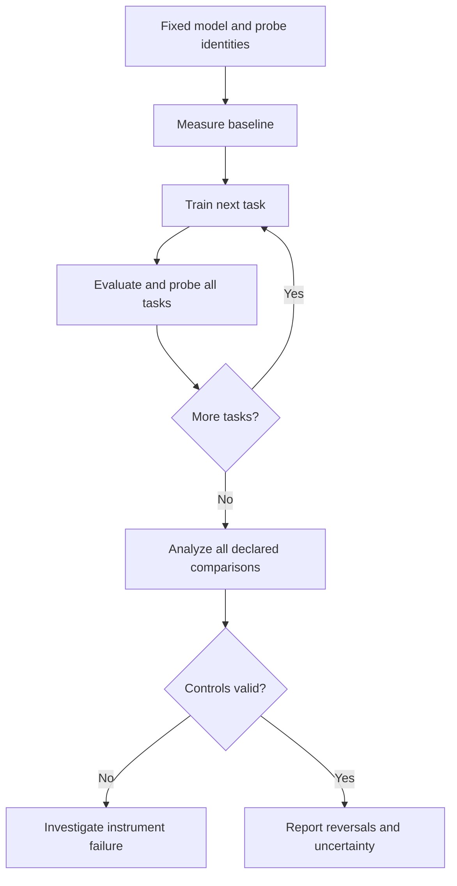

# What the H2 experiment code does — a complete explanation

Written 26 October 2026, Asia/Calcutta. This explains the delivered **H2 Robust Experiment v3** source.
Read this for understanding, then use [FULL_PIPELINE.md](FULL_PIPELINE.md) for the actual execution commands.
The formal choices and limitations are in [PROTOCOL.md](PROTOCOL.md).

**The central idea:** keep the measurement inputs fixed, train the same model through a sequence of tasks,
and ask whether the ordering of task-pair representation affinities reverses.
The software organizes training and measurement; the real experiment's results decide what evidence exists.

All numerical affinity/accuracy examples below are illustrative, not results from your H100.

## 1. The exact question being tested

Suppose we measure three tasks A, B and C inside a model. Initially the measured affinity between A and B
is higher than between A and C. After the model learns a sequence of tasks, that ordering might reverse.

| Measurement | Before continual training | After the final task |
|---|---:|---:|
| Affinity of A–B | 0.82 | 0.45 |
| Affinity of A–C | 0.60 | 0.70 |
| Difference: A–B minus A–C | +0.22 | −0.25 |

Initially A–B ranks above A–C. Finally A–C ranks above A–B. That is a **rank inversion**.
It is stronger than observing that a number changed. For example, 0.82 becoming 0.78 while
0.60 becomes 0.65 changes affinities but preserves their ordering.

For task pairs P and Q, the code defines

\[
D_t(P,Q)=A_t(P)-A_t(Q).
\]

A raw endpoint inversion satisfies

\[
D_0(P,Q)D_T(P,Q)<0.
\]

The opposite starting orientation counts too. What matters is the reversal, not which pair starts higher.
The code then asks whether the reversal is large and reliable enough to survive the declared uncertainty checks.

**H2 here is about the specified representation-affinity measurement.** Accuracy loss is not an H2 result by itself.
Neither is a training job finishing, a representation moving, or a graph showing two noisy lines touching.

## 2. What a “task” means in this experiment

A task is a particular labeled prediction problem. The default task set is:

| Task name in code | Dataset | What the model must predict |
|---|---|---|
| `yelp` | Yelp Polarity | Negative or positive review |
| `qqp` | QQP | Whether two questions have the same meaning |
| `qnli` | QNLI | Whether a sentence answers a question |
| `mnli` | MNLI | Entailment, neutral or contradiction |
| `ag_news` | AG News | World, sports, business, or science/technology |

One order is Yelp → QQP → QNLI → MNLI → AG News. Other orders use the same five tasks in different sequences.
The model learns one task's training split at a time. It does not mix old-task training examples into the next task.
That makes this a sequential-learning experiment without replay.

The input prompt identifies the task and its valid labels. Thus this is **task-aware classification**,
not an unknown-task test over every class in a combined label space.

## 3. The model already knows language before the experiment starts

The pipeline loads a pretrained model snapshot. It does not train a large language model from random weights.
The main model choices are Qwen3-4B and Qwen3-8B. Smaller smoke/model-replication and optional larger/full-tuning
profiles are also supplied.

“Before training,” or stage 0, means before **your continual-learning sequence**.
It does not mean before the model's original pretraining. Its initial representations already contain substantial structure.
The package also does not establish whether related benchmark examples appeared during pretraining.

Each new training trajectory starts again from the locked pretrained snapshot with a fresh adapter initialization.
Within that trajectory, the learned adapter persists from task to task.

## 4. What a representation is

When a sentence passes through a Transformer, each token acquires a hidden vector at each layer.
A hidden vector is a list of numbers used internally to process the input.

The experiment chooses a layer and turns its token vectors into one vector per example.
For the Qwen3-8B profile, the declared hidden width is 4,096. One example therefore becomes a vector with 4,096 coordinates.

With 1,000 probe examples for one task, the saved matrix has shape

\[
X_i^t\in\mathbb{R}^{1000\times4096}.
\]

Rows are examples. Columns are hidden-feature coordinates. The same probe inputs are passed through the model
at different checkpoints, so the matrix can change even though the input sentences stay fixed.

The scientific question concerns the relationships among these task representation matrices as learning proceeds.

## 5. How many checkpoints one trajectory has

For five sequential tasks, the engine makes six measurement stages:

| Stage | Model state |
|---|---|
| 0 | Before any task in this continual sequence |
| 1 | After learning the first task |
| 2 | After learning the second task |
| 3 | After learning the third task |
| 4 | After learning the fourth task |
| 5 | After learning the fifth task |

At every stage, it evaluates all five tasks and extracts the primary probe representations for all five tasks.
This includes tasks that have not yet been trained in that sequence.

Those future-task probes are measurement inputs, not optimization batches: extraction uses inference mode and
does not update the model. This is an offline experiment in which the researcher knows the benchmark task set.
It is not the H3 problem of forecasting an unknown future task from a truly unseen stream.

The primary statistical comparison is **stage 0 versus stage 5**.
Intermediate stages show the trajectory and can reveal transient crossings, but the primary inference does not
search freely through every possible time to select the most favorable crossing.

## 6. Why the code uses LoRA

Updating every parameter of a multi-billion-parameter model requires considerable gradient and optimizer memory.
The main profiles instead update small low-rank additions to selected attention projections.

For a frozen original matrix W, LoRA uses

\[
W_{\mathrm{effective}}=W+\frac{\alpha_L}{r_L}B_LA_L.
\]

The default adapter rank is \(r_L=16\), adapter alpha is 32, and dropout is 0.05.
The update targets attention `q_proj`, `k_proj`, `v_proj` and `o_proj` layers.
The original pretrained weights remain fixed; the added matrices learn.

**Freezing the original weights does not freeze the representation when LoRA is learning.**
The effective layer changes through \(B_LA_L\), which can change the hidden vectors produced for the same sentence.
That is how the LoRA trajectories can test H2.

The B matrices initially contain zeros, so the initial effective adapter update is zero.
The same cumulative adapter then learns task 1, task 2, and so on. The engine does not replace it
with a fresh task-specific adapter at every boundary.

Base weights use BF16 in the main profiles, while adapter parameters and their optimizer state use FP32.
The checkpoint format is custom to this package, rather than a standard PEFT adapter export.

## 7. Two different quantities called “rank”

This distinction is essential:

| Parameter | Default | Meaning |
|---|---:|---|
| LoRA rank \(r_L\) | 16 | Capacity of the trainable adapter update |
| Analysis rank \(r\) | 16 | Number of representation directions used to measure task affinity |

The defaults happen to have the same value. They are not the same parameter.
Changing LoRA rank changes the learning mechanism. Changing analysis rank changes the measurement.

The parameter stress suite includes LoRA ranks 8 and 32. The descriptive geometry sensitivity analysis
also examines analysis ranks 8 and 32, but those are separate operations with different interpretations.
LoRA alpha is an adapter scale; it is not the draft's theoretical lazy/rich output-scale parameter.

## 8. How the model is trained to give a label

The prompt states the task, its label mapping, the input text, and an `Answer:` suffix.
For a binary task the mapping might be A=negative and B=positive.
MNLI uses three codes; AG News uses four. Code meanings are determined by the current task prompt.

The tokenizer must represent A, B, C and D as distinct single reversible tokens.
The code checks this instead of assuming every tokenizer behaves the same way.

The correct answer code is the next-token target. Loss is full-vocabulary cross entropy for that one target:

\[
L=-\log p(\text{correct answer code}\mid\text{prompt}).
\]

Prompt tokens are not themselves training targets. Probe prompts do not contain the true answer appended to their text.

For classification accuracy, the prediction is the highest-scoring code among the current task's valid codes.
The model could still prefer some unrelated word over every code in its unrestricted vocabulary.
Therefore the evaluator also records the **invalid unrestricted top-1 rate** and the correct code's NLL.
High valid-code accuracy alone does not demonstrate good unconstrained text generation.

## 9. What the training settings mean

| Setting | Main default | Practical role |
|---|---:|---|
| Epochs per task | 2 | Two passes over that task's selected training examples |
| Microbatch | 1 | Examples processed in one forward/backward batch |
| Gradient accumulation | 16 | Combine gradients from up to 16 microbatches before an optimizer update |
| Learning rate | 0.0001 | Scale of AdamW updates, modulated by the schedule |
| Weight decay | 0.01 | AdamW parameter decay |
| Gradient clipping | 1 | Limit excessively large gradient norms |
| Maximum input length | 512 tokens | Preserve prompt structure while truncating source content if needed |
| Evaluation batch | 1 | Batch size for scoring and extraction |

With 20,000 training examples, microbatch 1 and accumulation 16:

\[
20{,}000/16=1{,}250\text{ optimizer updates per epoch}.
\]

Two epochs give 2,500 updates per task. Five tasks give 12,500 main updates per trajectory.
The 200-trajectory primary design therefore schedules 2,500,000 main optimizer updates.
That corresponds to 40 million training-example presentations, not 40 million unique examples.
Head controls, evaluation, extraction and bootstrap analysis add further work.

Warmup increases the learning rate initially, followed by a cosine schedule within each task.
The optimizer is reset at task boundaries, while learned adapter weights remain.
Thus this protocol studies parameter carryover without carrying Adam's moments from one task into the next.
Within-task recovery restores optimizer state, which is consistent with that boundary-reset policy.

## 10. How data preparation protects the measurement

The main requested split sizes are:

| Split | Examples per task | Used to update the model? | Purpose |
|---|---:|---|---|
| Train | 20,000 | Yes | Learn the current task |
| Validation | 1,000 | No | Learning and numerical checks |
| Probe A | 1,000 | No | Additional geometry sample for descriptive sensitivity |
| Probe B | 1,000 | No | Primary geometry measurement |
| Test | 2,000 | No | Fixed performance evaluation |
| Total | 25,000 | — | One task's selected rows |

Across five tasks this requests 125,000 selected rows, including 100,000 training rows, per data sample.
They are custom balanced holdouts from labeled source TRAIN portions, not official benchmark test splits.
The code does not simply train on every row in a downloaded dataset.

Data preparation resolves source dataset revisions, checks label mappings and builds bounded candidate pools.
It normalizes text for matching, removes exact duplicate records and excludes exact-content label conflicts.
Examples sharing an exact text field are linked into a group, including across tasks.
Approximate MinHash-LSH/Jaccard checks add detected long-text near duplicates to those groups.
Oversized components are excluded according to the declared limit.

Groups stay together within one split. For example, a repeated QQP question must not quietly occur in both
training and a probe set simply because its paired question differs.

Split roles are assigned by a stable group hash. Sampling seeds then select class-balanced quotas
within those roles. This prevents an unchanged source group from becoming training data in one repeated
sample and probe data in another sample built from the same pool.
The freeze audit also checks exact-field role leakage across the selected cohorts and reports same-role overlap.

These rules protect detected dependencies. Approximate deduplication can miss semantic relatives, and
normalization/grouping/exclusions can alter the population. They do not certify perfect independence or remove pretraining contamination.

If quotas cannot be filled, preparation stops with deficits. It does not duplicate rows or silently shrink the experiment.

## 11. Development data and confirmation data

Smoke/calibration use a development pool, while main confirmation uses a separate exact-field hash pool.
Every normalized field in an example must belong to the chosen pool; mixed-pool multi-field examples are excluded.

The intended workflow is to inspect development behavior, fix the scientific choices, then run confirmation.
Otherwise repeated tuning after looking at main outcomes can make a favorable result a selection artifact.

The two main data samples use different sampling seeds but can share examples and source groups.
The software reports overlap. They are **subsampling replications from shared sources**, not independent datasets.
Training seeds, task orders, probe resampling and data resampling answer different uncertainty questions.

## 12. Why fixed probes are central to H2

If we used new sentences after every task, a changed affinity could come from changed input samples.
The code instead preserves probe row IDs, order, labels and group IDs across checkpoints.
It verifies those identities before comparing stages.

Thus the changing object is the model's response to those fixed inputs.
This isolates model-induced changes from simply replacing the measurement sample.
Finite probes still have sampling uncertainty, which is why bootstrap analysis is needed.

For content pooling, the tokenizer's offsets identify tokens entirely inside source-text spans.
The primary vector is the mean of their hidden vectors; padding and direct instruction-token vectors are excluded.
The hidden states still depend on the preceding prompt through contextual computation.
“Content pooling” does not make the representation completely free of prompt effects.

Alternative answer-position and last-content-token poolings are saved for descriptive checks.

## 13. From example vectors to a task subspace

A task is represented by a matrix, not just one sentence vector. The primary analysis first subtracts
the mean of every feature column within that task:

\[
X_{i,c}^t=X_i^t-\mathbf{1}\mu_i^{t\top}.
\]

This is centering. It makes the estimator focus on variation around that task's mean representation.
Consequently, pure movement of task means is outside this primary measurement.

Singular value decomposition then finds the main directions of variation. Intuitively, rather than retaining
every hidden coordinate equally, the analysis identifies a small set of directions along which the example vectors vary most.
It keeps the top 16 **right singular vectors**, arranged as a hidden-width-by-16 basis V_i.

The right singular vectors live in hidden-feature coordinates. Left singular vectors live in sample coordinates.
Tasks can have unrelated examples, so comparing sample-coordinate bases would not be the same measurement.
The code uses the common hidden-feature coordinates of the same model/layer.

High-variance directions may reflect task information, writing style, length or other nuisance factors.
The implementation measures this declared geometry; it does not establish that every retained direction is task-relevant.

## 14. How the code calculates affinity

For two task bases V_i and V_j, each with 16 orthonormal columns, the affinity is

\[
A_t(i,j)=\frac{\|V_i^{t\top}V_j^t\|_F^2}{16}.
\]

This measures overlap between their leading feature subspaces. Equivalently it is the average squared cosine
of their principal angles.

| Value | Meaning for this estimator |
|---|---|
| 1 | The selected subspaces coincide |
| Near 1 | Strong overlap |
| Intermediate | Partial overlap |
| Near 0 | Weak overlap |
| 0 | Orthogonal selected subspaces |

The matrix is symmetric. Its diagonal is 1; diagonal entries are not used as task-pair comparisons.
The score is nonnegative, so it is not the same as a signed gradient cosine or your earlier signed synthetic task-similarity matrix.

A shared orthogonal rotation of every task's feature coordinates preserves this overlap.
An arbitrary anisotropic scaling can change it, including under a compensated change that preserves outputs.
Therefore an affinity reversal alone does not establish behavioral harm or reject every gauge explanation.

## 15. Why there are 45 comparisons per trajectory

Five tasks have

\[
\binom{5}{2}=10
\]

distinct unordered task pairs. H2 compares the affinities of two such pairs, giving

\[
\binom{10}{2}=45
\]

pair-of-pair comparisons.

Pairs can share a task, such as Yelp–QQP versus Yelp–QNLI, or use different tasks.
All 45 are reported. The program does not show only the most dramatic crossing.
The comparisons share tasks and probes, so they are dependent measurements, not 45 independent experiments.

## 16. Why a raw sign change is not enough

Consider differences of +0.0002 before training and −0.0001 after training.
The sign changed, but the ordering could be a near-tie affected by finite sampling or numerical variation.

The primary rule uses an affinity-difference margin of 0.01 and simultaneous uncertainty intervals.
For one orientation, it requires

\[
\operatorname{lower}(D_0)>0.01,
\qquad
\operatorname{upper}(D_T)<-0.01.
\]

The reverse orientation is treated symmetrically.
For the example in section 1, hypothetical intervals [0.18,0.26] initially and [−0.29,−0.21] finally
would satisfy this rule. Intervals that include a tie or cross the margin would not.

The 0.01 is on the affinity-difference scale. It is not a one-percentage-point accuracy requirement.
It is a declared practical threshold needing justification before confirmation, rather than a universal constant derived by the code.

## 17. What the 2,000 bootstrap draws do

The learned checkpoints are fixed during bootstrap analysis.
The analyzer repeatedly resamples detected probe source groups with replacement, refits centered subspaces,
recalculates affinities and recomputes endpoint differences.

A sampled group gets one multiplicity shared wherever it appears across tasks.
The same draw is used at both endpoints and across runs with the same probe identities.
This pairing preserves important dependencies when measuring a difference in geometry.

From the bootstrap variation, the code estimates standard errors and a maximum standardized-error critical value.
The resulting intervals account jointly for the registered endpoint differences in the cell.
Numerically rank-deficient draws are not retried selectively until a favorable answer appears; they cause an analysis failure.

**Two thousand bootstrap draws are not two thousand newly trained models.**
They quantify probe-sampling uncertainty conditional on the trained checkpoints and the detected grouping assumptions.
They do not replace training-seed repetitions, independent populations, or new architectures.
The interval construction is approximate, not an exact finite-sample coverage theorem.

## 18. What a cell is, and how the whole family is adjusted

A cell fixes a model, data-sampling seed and training-parameter variant.
The main profile has four cells: two models times two data samples, using the reference training settings.
Each cell has 50 main trajectories (10 seeds × 5 orders) and two fixed-encoder controls.

For one primary cell, the joint interval family includes

\[
52\text{ runs}\times2\text{ endpoints}\times45\text{ comparisons}=4{,}680
\]

endpoint quantities. Across four cells there are 18,720 endpoint quantities, with substantial dependence.
The primary program uses joint bootstrap intervals within each cell and Bonferroni allocation across all four registered cells:

\[
\alpha_{\text{cell}}=0.05/4=0.0125.
\]

This targets an overall error level under the method's assumptions; approximate bootstrap coverage still limits the claim.
Analyzing only one cell does not reduce the declared family to that favorable cell.
Use `reports/NAME/CELL/joint_pair_comparisons.csv` for the suite-adjusted decisions, rather than treating an isolated per-run result as the final claim.

Separate primary/stress/replication suites have separate families. Searching across them and reporting the best
individual 0.05 result does not make the overall search a 0.05 test.

## 19. What repeated seeds and task orders add

A training seed controls pseudorandom choices such as adapter initialization, dropout and shuffling.
Task order changes which learning comes first and what can overwrite or reshape what came earlier.
These are substantive repetitions and conditions, not extra bootstrap draws.

The main profile uses 10 seeds and five declared orders for every model/data cell.
This makes it possible to ask whether a particular reversal repeatedly appears instead of relying on one favorable trajectory.
The same-seed runs across orders share randomness structure; the analysis treats seeds as blocks for a descriptive summary.
Five orders do not cover all 120 possible permutations, and deterministic settings do not guarantee identical results across every software/device version.

The declared descriptive repetition criterion is:

1. The same pair-of-pairs comparison reverses in the same orientation.
2. It is interval-eligible in at least 80% of the training seeds for an order.
3. This holds in at least three of the five primary orders.

For the primary profile, this means at least eight of ten seeds in at least three orders.
This is a descriptive consistency rule, not a separate population p-value.
The underlying comparisons and their failed flags remain available in the CSV.

## 20. The frozen-model and head-only controls

Each cell includes two controls:

| Control | What learns? | What should happen to encoder representations? |
|---|---|---|
| Frozen model | Nothing | Remain unchanged apart from allowed numerical tolerance |
| Head-only | A small linear readout; encoder stays frozen | Remain unchanged even while the readout learns |

If the measuring instrument claims substantial encoder changes while the encoder is fixed, investigate the instrument,
input identities, numerical behavior or loading procedure before interpreting H2.

The code checks maximum absolute feature changes against tolerance 0.0001 across the saved stages/views.
It also verifies that the head-only readout actually updated its parameters.
A frozen control showing an interval-supported inversion makes the suite analysis fail.

The head-only control uses a separate four-output classifier on final-layer content features.
It is useful for checking encoder invariance; its accuracy is not a perfectly matched language-model-vocabulary baseline.
There is one control of each type per cell, not a control run for every training seed/order combination.

## 21. Learning and spectral checks

The pipeline does not accept “the GPU worked” as evidence that the model meaningfully learned.
Its learning audit compares validation metrics immediately before and after each task's own training.

At least two tasks must satisfy both:

- Target NLL decreases by more than 0.01.
- Post-task valid-code accuracy is at least chance plus 0.05.

For a binary task, the second threshold is 55% accuracy. For a four-class task, it is 30%.
These are declared quality checks, not optimality guarantees or evidence that all five tasks learned well.
The per-task readings are retained, including initial-sequence versus post-task gains.

The code also examines the singular values around the chosen analysis rank.
If singular values 16 and 17 are almost tied, small probe changes can rotate which directions make it into the top 16.
It saves the relative cutoff gap

\[
\frac{\sigma_r-\sigma_{r+1}}{\sigma_r}.
\]

For the declared eligibility summary, every involved task/endpoint must meet the default gap threshold 0.001.
An interval-supported reversal failing learning or spectral eligibility remains in the detailed output with its failed flag.
The thresholds are predeclared choices; they are not universal mathematical boundaries between good and bad experiments.

## 22. What “multiple parameters” means here

The stress suite uses 11 settings, each with three seeds and three orders:

| Variant | Change from the reference |
|---|---|
| `reference` | lr0.0001, LoRA rank16/alpha32, dropout0.05, length512, two epochs |
| `lr_low` | Learning rate0.00003 |
| `lr_high` | Learning rate0.0003 |
| `adapter8` | LoRA rank8 and alpha16 |
| `adapter32` | LoRA rank32 and alpha64 |
| `no_dropout` | LoRA dropout0 |
| `dropout10` | LoRA dropout0.1 |
| `length256` | Maximum input length256 |
| `length1024` | Maximum input length1024 |
| `one_epoch` | One epoch/task |
| `three_epochs` | Three epochs/task |

Changing one factor around a reference helps identify sensitivity. It is not a full factorial test of every interaction.
Ranks 8/16/32 use alpha=2r so the nominal adapter scaling factor stays2.
There are 11×3×3=99 main trajectories plus22 controls:121 total scheduled runs.

The separate measurement-sensitivity CSV examines analysis rank, layer, pooling, Probe A and covariance overlap.
Those outputs are descriptive. Selecting a favorable secondary measurement does not inherit the primary confidence claim.

## 23. The complete primary design and its cost

The main design is

\[
2\text{ models}\times2\text{ data samples}\times10\text{ seeds}\times5\text{ orders}
=200\text{ training trajectories}.
\]

Four cells add eight controls, giving208 runs.
This is a substantial configured study, not208 independent draws from every possible model/task population.

Primary Probe B/content/primary-layer features are stored at all six task-boundary stages.
Additional layers, poolings and Probe A are stored at the two endpoints, reducing disk use.
The budget estimates about515.75GiB of uncompressed features for the default primary matrix.
Model/token/data caches, adapter and optimizer checkpoints, full-tuning checkpoints, reports and interrupted attempts add overhead.

Disk space, system RAM and GPU memory are different resources.
Your earlier approximately39.5GiB H100 MIG device is a partition of a GPU, not the full card.
The declared memory floors are planning guards, not guarantees that every sequence will fit.
Runtime estimates require actual calibration; GPU memory alone does not determine total study duration.

## 24. Why the execution stages are separated

| Stage | What the program does | Why it comes before the next stage |
|---|---|---|
| Setup | Prepare isolated dependencies and run tests | Check the instrument/runtime |
| Build | Write the full planned matrix and configs | Define what will be measured |
| Prepare | Cache model/data, audit groups/splits, tokenize | Provide fixed, identified assets |
| Smoke | Run a tiny trajectory and controls | Find execution and measurement failures cheaply |
| Calibration | Train development subsets on matching model/settings | Check learning, memory, timing and controls |
| Freeze | Record the plan, source/asset identities and required audits | Preserve choices before confirmation |
| Main execution | Run the registered model/seed/order matrix | Collect actual trajectories |
| Analysis | Refit geometry and compute declared uncertainty | Evaluate H2 evidence |
| Sensitivity | Inspect alternative measurements | Describe boundaries and motivate later confirmation |

Each executable smoke/calibration plan has its own build/prepare/freeze steps too.
The main freeze requires successful matching learning calibration and passing calibration controls.
A positive inversion is never a calibration requirement.

The following diagram shows the core loop inside one registered trajectory, followed by its analysis:

The actual controls are separate registered trajectories. The diagram summarizes their role in validating interpretation.

## 25. What the H100, CPU and PBS each do

The GPU performs the expensive model forward/backward calculations, evaluation and feature extraction.
CPU jobs handle preparation, identity audits and bootstrap/subspace analysis.
Bootstrapping can still be expensive after GPU training finishes.

PBS is the scheduler used by the recorded college workflow. A `qsub` command submits a script to it.
A queued job has not trained yet; a running job has not necessarily finished successfully.
The login shell is for lightweight navigation, editing, submission and monitoring.

The code uses currently authorized device selection and preserves a device supplied by the scheduler.
Setting a device UUID or enabling the whole-GPU flag does not reserve or authorize an allocation.
The scheduler scripts request system resources; the actual college GPU-allocation procedure remains necessary.

The submitter defaults to a bounded window of eight jobs and chains accepted GPU jobs serially.
It records actual PBS IDs and attempts to reconcile active deterministic job names before retrying.
It does not automatically launch all208 trajectories just because the profile exists.

## 26. What happens if a long job stops

During training, the engine saves optimizer-step checkpoints every100 updates, at task completion and at a cooperative pause.
They include trainable parameters, optimizer state, batch cursor and Python/NumPy/Torch/CUDA random states.
The intended result is continuation of the same trajectory, rather than starting a new random experiment.

Completed stages also have parameter checkpoints, metrics, features and hashes.
Interrupted feature extraction repeats the affected stage; completed artifacts are verified before reuse.
Hard termination can lose work after the latest saved optimizer checkpoint.
An event log may contain replayed task/update IDs after recovery, while the completed task summary records the final actual totals.

A resumed allocation is another attempt at the same training trajectory, not another independent replication.
The time-budget margin and scheduler walltime must be configured consistently.
No handler can save a checkpoint after an uncatchable hard kill.

## 27. File-by-file map

| File | Main responsibility |
|---|---|
| `suite.py` | Build plans, prepare/freeze/submit them, run registered trajectories, audit learning and controls, estimate budgets |
| `h2/tasks.py` | Dataset locations, input fields, labels and task instructions |
| `h2/data.py` | Normalization, candidate sampling, duplicate/group detection and leakage audits |
| `h2/robust_data.py` | Stable group-to-split roles and repeated quota sampling |
| `h2/prepare.py` | Resolve/capture assets, construct selected splits and token caches |
| `h2/prompts.py` | Render prompts, validate label tokens, truncate content, build masks and pool hidden states |
| `h2/lora.py` | Insert low-rank attention updates and save/restore trainable parameters |
| `h2/engine.py` | Train each task, evaluate, extract representations and commit stage outputs |
| `h2/checkpoints.py` | Atomic checkpoint writes, cooperative pause and process locks |
| `h2/gpu.py` | PBS/device/occupancy/CUDA checks |
| `h2/geometry.py` | SVD subspaces, affinities, group-bootstrap indices and interval/inversion rules |
| `h2/analyze.py` | Per-run affinity trajectories, bootstrap arrays, performance summaries and plots |
| `h2/suite_analysis.py` | Joint cell intervals, suite multiplicity, eligibility, controls and descriptive replication |
| `h2/plotting.py` | Figures illustrating the saved measurements |
| `h2/common.py` | Paths, config loading, hashing, software inventory and common utilities |
| `pbs/` | CPU/GPU/setup job scripts for scheduled execution |
| `validate_statistics.py` | Synthetic instrument coverage/detection diagnostics |
| `tests/` | Software/instrument regression tests and tiny real-backend checks |
| `verify_package.py` | Check delivered file hashes before building server plans |

The old `submit_campaign.py`, `status.py` and v2 configs are retained for source continuity and regression tests.
Use `suite.py` and the v3 runbook for the delivered suite.

## 28. Which outputs to inspect

| Output | The question it answers |
|---|---|
| `plans/NAME/plan.json` | What exactly was planned? |
| `plans/NAME/FROZEN.json` | Which source, assets and checks were fixed before confirmation? |
| `plans/NAME/submissions.json` | Which actual jobs were submitted or continued? |
| `runs/NAME/CELL/RUN/run.json` | Which configuration, data/model identities and environment belong to this trajectory? |
| `attempts.jsonl` | Which execution attempts belong to the same trajectory? |
| `stages/stage_NNN/training.json` | How many examples/tokens/updates actually completed? |
| `stages/stage_NNN/metrics.json` | What happened to accuracy, F1, NLL and invalid outputs? |
| `stages/stage_NNN/features/` | What fixed-probe representation arrays were measured? |
| `analysis/.../affinity_trajectories.csv` | How did each task-pair affinity move across stages? |
| `reports/NAME/execution_status.csv` | Which registered trajectories are complete, missing or failed? |
| `reports/NAME/CELL/joint_pair_comparisons.csv` | Which individual reversals pass joint intervals, learning and spectrum checks? |
| `reports/NAME/CELL/cell_report.json` | Did controls pass, and which comparisons met descriptive repetition? |
| `reports/NAME/suite_report.json` and `summary.md` | Is the full suite complete, and what happened across cells? |

Backward transfer is also reported: final old-task accuracy minus its accuracy immediately after its own training,
averaged over old tasks. This is related to forgetting but is not the primary H2 statistic or a causal effect of affinity.

Selected figure panels illustrate the same measurements; they are not fresh confirmation.
Read the detailed rows and failed flags, not only a plot or a single summary count.

## 29. How to interpret the possible outcomes

| Outcome | Appropriate interpretation |
|---|---|
| Valid controls, eligible reversals repeated across the declared seeds/orders | Evidence supporting measured H2 in these conditions |
| Some eligible reversals but no declared repetition | Observed reversals with weaker stability evidence |
| Raw crossings with wide intervals or near ties | Inconclusive ordering at the chosen resolution |
| Interval reversals failing spectral/learning checks | Recorded measurements requiring those qualifications |
| No eligible reversals | No support at this protocol's resolution; inspect why eligibility failed |
| Frozen-control drift or inversions | Instrument validity problem; investigate before scientific interpretation |
| Missing/failed trajectories | Incomplete registered experiment |
| OOM, missing cache, queue failure or corrupted files | Execution/integrity failure, not a negative H2 result |

In particular, zero eligible reversals can mean several different things: stable ordering, insufficient precision,
an unstable selected subspace, inadequate learning, or an endpoint test missing a transient crossing.
The flags and diagnostics distinguish these possibilities as far as the recorded measurements allow.

## 30. What this code can establish, and the present status

A positive completed study can support this claim:

> Under the declared pretrained models, task streams, update rules, probes and affinity estimator,
> task-pair affinity orderings exhibited uncertainty-supported reversals with the reported repetition and controls.

It does not turn representation affinity into semantic similarity, signed gradient interference or causality.
H3 needs its own forward held-out forecasting test. H4 needs its own controlled intervention.
The package does not establish literature novelty or prove H2 for every possible model and task population.
The optional full-tuning profiles are not a complete implementation of every phase of the draft.

At delivery,32 local tests were discovered:30 passed and two real Transformer backend tests were skipped because
the local dependencies were incompatible. The server setup requires those backend tests to run and pass.
Synthetic Gaussian diagnostics exercised the instrument but are not real-model H2 evidence.
No actual full H100 study or real-data H2 result was completed by creating this code package.

To proceed, understand the measurement in this file, then follow the staged commands in
[FULL_PIPELINE.md](FULL_PIPELINE.md): setup → smoke → calibration → main protocol freeze → execution → analysis.
The code is an instrument for a falsifiable experiment. Its value is that both supportive and unsupportive outcomes
can be traced to the declared inputs, measurements, controls and uncertainty.
